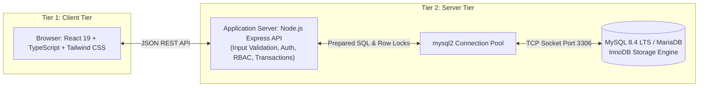

# Sports Facilities Management System (SFMS)

An intermediate-level engineering college Database Management Systems (DBMS) course project demonstrating relational database design, 3NF schema normalization, InnoDB row-level locking concurrency control, and analytical reporting in MySQL 8.4 LTS / MariaDB.

---

## 1. System Architecture: Two-Tier Client/Server



- **Client Tier:** Modern React SPA with accessible forms, role navigation, and visual scheduling timelines.
- **Server Tier:** Express REST API containing strict server-side authentication, role authorization, and parameterized SQL executed over a dedicated connection pool to MySQL/InnoDB. The browser never holds database credentials or directly accesses the DBMS.

---

## 2. Actors & Pre-configured Demo Accounts

All demo accounts share the verified bcrypt-hashed password: `password123`.

| Full Name | Role | Email | Capabilities |
|---|---|---|---|
| **Dr. Marcus Vance** | `ADMIN` | `admin@campus.edu` | Approvals queue, facility manager, equipment inventory, maintenance dispatch, analytical reports & views. |
| **Elena Rostova** | `MAINTENANCE_STAFF` | `staff@campus.edu` | View assigned work orders, update repair status, log resolution notes. |
| **James Miller** | `MAINTENANCE_STAFF` | `staff2@campus.edu` | Physical plant technician assigned to facility safety repairs. |
| **Sarah Chen** | `MEMBER` | `member@campus.edu` | Browse venues, check availability, request bookings, view history, cancel own bookings, report issues. |
| **Alex Rivera** | `MEMBER` | `alex.student@campus.edu` | Student athlete account for testing adjacent intervals and multi-user concurrency. |

*Note:* You can switch seamlessly between any of these accounts with the **1-Click Quick Role Switcher** in the top navigation bar.

---

## 3. Database Design & Relational Schema (3NF)

### Tables
1. `users`: System users and authorization roles (`MEMBER`, `ADMIN`, `MAINTENANCE_STAFF`).
2. `sport_types`: Controlled lookup catalog for sports (Badminton, Basketball, Tennis, Swimming, Volleyball, Squash).
3. `facilities`: Physical venues with capacity, hourly rate, indoor/outdoor indicator, and operational status (`ACTIVE`, `INACTIVE`, `MAINTENANCE`).
4. `operating_hours`: Weekly opening windows per facility and weekday (`day_of_week` 0 to 6, `opens_at`, `closes_at`).
5. `bookings`: Member reservations with half-open intervals `[start_at, end_at)`, participant count, purpose, price snapshot, and status (`PENDING`, `APPROVED`, `CANCELLED`, `REJECTED`, `COMPLETED`).
6. `equipment`: Asset inventory tied to venues with unique `asset_tag` barcodes and condition statuses.
7. `maintenance_reports`: Hazard/defect logs submitted by users with severity ratings (`LOW`, `MEDIUM`, `HIGH`, `CRITICAL`).
8. `work_orders`: Actionable maintenance assignments linked 1:1 to reports and assigned to staff technicians.
9. `audit_logs`: Immutable tracking of critical state transitions and administrative decisions.

### Normalization Rationale
- **1NF:** Atomic scalar values in all columns; no repeating groups or comma-separated lists.
- **2NF:** Single surrogate primary keys; natural composite candidate keys (e.g. `(facility_id, day_of_week)`) enforced via unique constraints.
- **3NF:** No transitive dependencies. Facility names, sport names, and user attributes live in their respective primary tables and are resolved via foreign key joins.
- **Historical Snapshot Exception:** `hourly_rate_at_booking` and `total_price` in `bookings` represent immutable historical financial records at reservation time, not redundant copies of current facility rates.

---

## 4. Critical Concurrency Control: The Booking Transaction

MySQL does not support native temporal exclusion constraints for arbitrary intervals. To prevent race conditions under concurrent reservation requests targeting the same venue:

1. **Transaction Boundary:** Check out a dedicated connection from the connection pool and run `conn.beginTransaction()`.
2. **Row-Level Lock:**
   ```sql
   SELECT facility_id, capacity, hourly_rate, facility_status 
   FROM facilities 
   WHERE facility_id = ? 
   FOR UPDATE;
   ```
   This serializes competing requests for the *same facility* while allowing independent venues to be booked concurrently.
3. **Half-Open Interval Overlap Check:**
   ```sql
   SELECT booking_id, start_at, end_at, status 
   FROM bookings 
   WHERE facility_id = ? 
     AND status IN ('PENDING', 'APPROVED') 
     AND start_at < ?   -- requested_end
     AND end_at > ?     -- requested_start;
   ```
   If count > 0, execute `conn.rollback()` and return HTTP `409 Conflict`.
4. **Insert & Commit:** Insert booking and commit atomically.

---

## 5. SQL Query Library & Analytical Views

- `v_pending_bookings`: Pre-joined administrative approval queue.
- `v_facility_booking_summary`: Aggregated booking metrics, revenue estimates, and latest reservation timestamps.
- `v_maintenance_backlog`: Unresolved defects and assigned technicians.
- `sp_get_facility_booking_summary(p_start, p_end)`: Stored procedure demonstrating parameterized date-window aggregations.

---

## 6. Setup & Verification Commands

### Start Server
```bash
npm run dev
```
Starts Express API and Vite frontend on `http://localhost:3000`.

### Run Unit Tests
```bash
npm test
```
Executes Node.js 22 built-in test suite (`src/utils/rules.test.ts`) verifying:
- Interval overlap algebra
- Adjacent interval acceptance
- Capacity and operating hour validation
- Cancellation role authorization rules

### Database Migrations & Seeds
```bash
mariadb -u sfms_app -psfms_secure_pass123 -h 127.0.0.1 -D sfms < database/migrations/001_schema.sql
mariadb -u sfms_app -psfms_secure_pass123 -h 127.0.0.1 -D sfms < database/views/001_views.sql
mariadb -u sfms_app -psfms_secure_pass123 -h 127.0.0.1 -D sfms < database/procedures/001_procedures.sql
mariadb -u sfms_app -psfms_secure_pass123 -h 127.0.0.1 -D sfms < database/seeds/001_demo_data.sql
```

---

## 7. Academic Evidence & Literature Screen

1. **Mahathir et al. (2025):** *Design and Implementation of a Relational Database System for Efficient Facility and Booking Management.* Preprints.org, DOI: `10.20944/preprints202503.0070` (Academic Preprint).
2. **Frontiers in Psychology (2021):** *Design and Implementation of Intelligent Sports Training System for College Students' Mental Health Education.* DOI: `10.3389/fpsyg.2021.634978`.
3. **Oracle Corporation (2024):** *MySQL 8.4 Reference Manual: InnoDB Locking and Transaction Model.*
4. **Literature Screening Note:** A 2022 paper on sports equipment management in *Scientific Programming* was retracted by the publisher; it was screened and excluded from our citations.
