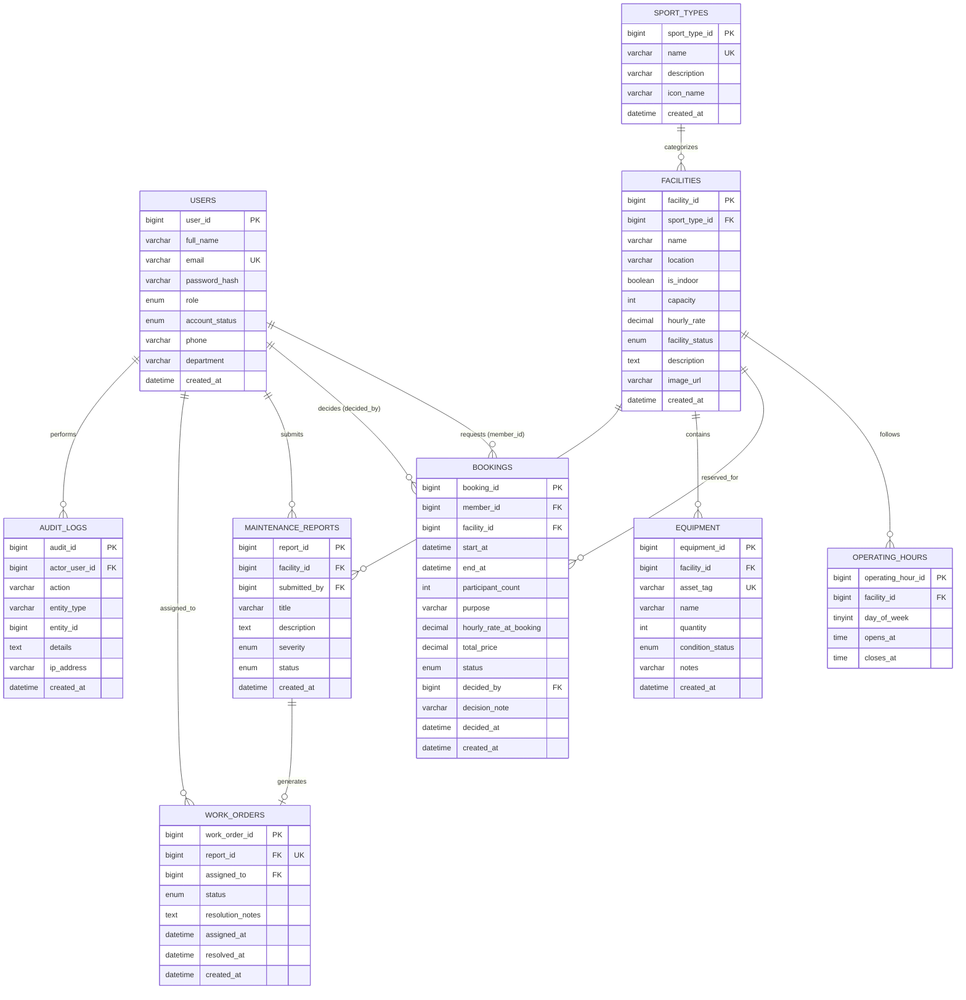

# Data Model, ERD, and Normalization

## 1. Conceptual Entity-Relationship Diagram (Mermaid)

## 2. Relational Schema and Normalization (3NF)

### First Normal Form (1NF)
- All attributes contain strictly atomic values.
- Repeating groups or comma-separated lists (e.g., storing multiple equipment items or days of the week in a single column) are eliminated.
- Primary keys are formally defined on all tables.

### Second Normal Form (2NF)
- The schema is in 1NF.
- All non-key attributes depend fully on the primary key, rather than any partial component of a composite key.
- Operating hours naturally identify by `(facility_id, day_of_week)`, which is enforced via a UNIQUE candidate key constraint alongside a surrogate `operating_hour_id` primary key.

### Third Normal Form (3NF)
- The schema is in 2NF.
- There are no transitive dependencies among non-key attributes:
  - `facility_name` and `sport_name` are not duplicated inside `bookings`.
  - User details (`full_name`, `email`) are referenced exclusively via `member_id` foreign keys.
  - Equipment and work order lifecycles exist in their own relations.
- **Deliberate Historical Snapshot Exception:**
  `hourly_rate_at_booking` and `total_price` in `bookings` represent immutable historical financial facts at reservation time, not redundant copies of the current facility price. If the facility rate is adjusted in the future, past booking contracts remain unaffected.

## 3. Deliberate Indexing Plan

| Table | Index Columns | Index Type | Purpose |
|---|---|---|---|
| `users` | `(email)` | UNIQUE | Fast O(log N) login authentication lookup. |
| `sport_types` | `(name)` | UNIQUE | Ensures canonical sport naming. |
| `operating_hours` | `(facility_id, day_of_week)` | UNIQUE | Fast lookups for daily opening bounds; prevents conflicting schedules. |
| `bookings` | `(facility_id, status, start_at, end_at)` | Composite B-Tree | High-speed range filtering for the reservation overlap predicate. |
| `bookings` | `(member_id, created_at)` | Composite B-Tree | Fast retrieval of user's personal booking history in reverse chronological order. |
| `bookings` | `(status, start_at)` | Composite B-Tree | Powers administrative approval queue and time-series aggregation. |
| `equipment` | `(asset_tag)` | UNIQUE | Fast inventory barcode / asset tag lookup. |
| `work_orders` | `(report_id)` | UNIQUE | 1:1 enforcement between reports and work orders. |
| `work_orders` | `(assigned_to, status)` | Composite B-Tree | Staff dashboard filter for assigned open tasks. |

## 4. Timezone Specification
All booking and audit timestamps are stored as `DATETIME` adhering to the campus local timezone: `America/Los_Angeles` (configured in `.env.example`).
Booking intervals are half-open intervals: `[start_at, end_at)`.
This mathematically permits adjacent reservations without collision:
- Slot 1: `[09:00:00, 10:00:00)`
- Slot 2: `[10:00:00, 11:00:00)`
Slot 1 ends at 10:00:00, and Slot 2 starts at 10:00:00; because `10:00:00 < 10:00:00` evaluates to `FALSE`, the overlap condition is not met.
